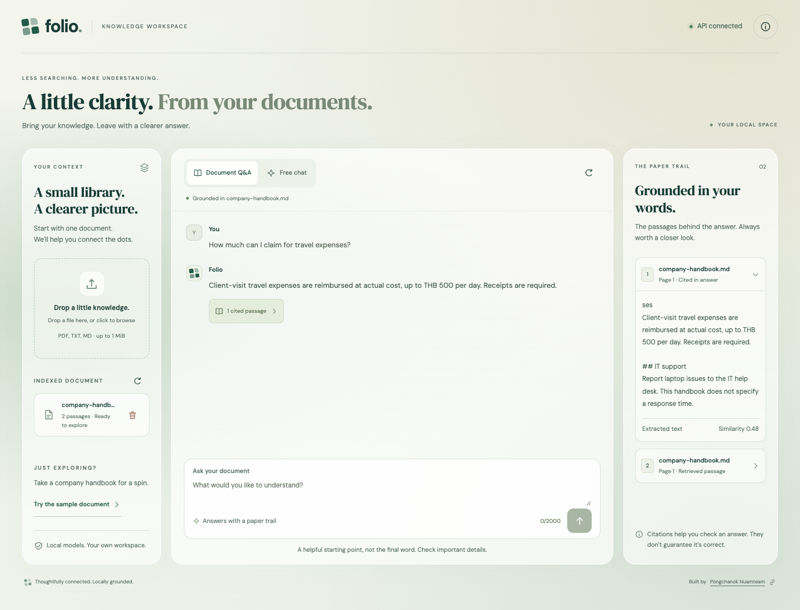

# Enterprise Knowledge Assistant — Folio

A local document knowledge workspace with a responsive glass UI, built with **Next.js, FastAPI, Ollama and PostgreSQL + pgvector**.
Upload a TXT, Markdown or PDF (with Thai/English OCR fallback), ask questions, and inspect cited passages with page numbers.



[Mobile preview](docs/screenshots/folio-mobile.png) · [Frontend implementation and testing](frontend/README.md)

## Run with one command

Install [Git](https://git-scm.com/downloads) and [Docker Desktop](https://www.docker.com/products/docker-desktop/),
then start Docker Desktop. On Windows, use its **Linux containers** backend (WSL 2 is recommended).
You can run the launcher directly in Windows PowerShell; a WSL terminal is not required.
Recommended: 16 GB system RAM, at least 8 GB available to Docker and 15 GB free disk.
Internet is required for the first download.

Clone the development branch (the default `main` branch may not contain these changes yet):

```text
git clone --branch develop https://github.com/yousan-nim/Enterprise-Knowledge-Assistant-BasicRAG.git
cd Enterprise-Knowledge-Assistant-BasicRAG
```

**macOS (Intel / Apple Silicon), Linux, or Windows WSL:**

```bash
sh scripts/dev.sh
```

**Windows PowerShell or Command Prompt:**

```powershell
powershell.exe -NoProfile -ExecutionPolicy Bypass -File .\scripts\dev.ps1
```

The Windows command sets the execution policy only for that process; it does not change your machine's
policy. Both launchers run the same Linux containers and create the same `.env` format. No Bash, Python,
OpenSSL or separately installed Ollama is required on Windows. If an organization enforces a restrictive
PowerShell policy, follow that policy or use the WSL command.

Open **http://localhost:3000** for the workspace. API docs remain at **http://localhost:8080/docs**. No Python installation, API key or separate Ollama installation is required.
The launcher generates a local, Git-ignored `.env` if none exists, builds the frontend and backend, starts PostgreSQL
and Ollama, downloads `embeddinggemma` and `qwen2.5:3b`, and waits for the API to become healthy.
The first run downloads several GB and may take several minutes; subsequent runs reuse Docker volumes.

This portable setup runs Ollama on CPU. On a Mac it does not use native Metal acceleration, so generation
can be slower than running Ollama directly on the host. The responsive Next.js workspace supports document upload, grounded Q&A, source inspection and direct chat. There is no authentication. Services published to the host
bind to loopback for local demos.

### Faster inference on Mac / host GPU

Docker Ollama cannot use Apple Metal. To use native Ollama instead, open the host Ollama app
and install `embeddinggemma` and `qwen2.5:3b` with `ollama pull <model>` if needed, then run:

```bash
sh scripts/dev.sh --native
```

Windows with host Ollama installed can use:

```powershell
powershell.exe -NoProfile -ExecutionPolicy Bypass -File .\scripts\dev.ps1 -NativeOllama
```

This selects `docker-compose.native.yml`: only the frontend, backend, PostgreSQL and a model-presence
check are started. The backend uses `http://host.docker.internal:11434`. Missing host models fail
startup rather than being downloaded or updated automatically. Docker Desktop must be able to reach
the host Ollama port; test that before changing its bind address. If access requires `OLLAMA_HOST`,
follow the [Ollama configuration guide](https://docs.ollama.com/faq#how-do-i-configure-ollama-server)
and restrict access to your trusted machine/network: Ollama has no API authentication by default.
Use `ollama ps` during generation to check GPU use.

To retain native mode for ordinary `docker compose` commands on macOS, add this to your local `.env`:

```dotenv
COMPOSE_FILE=docker-compose.yml:docker-compose.native.yml
```

PowerShell on Windows uses `;` instead of `:` for `COMPOSE_FILE`. Remove that setting to return to
the portable Docker mode. An already-running Docker Ollama can be stopped with `docker compose stop ollama`;
its model volume is retained. Keep the same embedding model digest when switching runtimes, and compare
vectors before reusing an existing index; changing embedding models requires re-indexing. Neither launcher
clears stored documents. The native override uses Compose's [`!reset` merge tag](https://docs.docker.com/reference/compose-file/merge/).

### API process diagrams

Choose **API Flows** in the navbar, or open **http://localhost:3000/api-flows**.
The six endpoint diagrams include the frontend proxy and native/Docker Ollama deployment notes.
The source is `docs/diagrams/api-endpoints.html`; keep its published copy at
`frontend/public/diagrams/api-endpoints.html` in sync when updating the diagrams.

### Try the workflow

1. Open the workspace and choose **Try the sample document**, or upload your own PDF/TXT/Markdown file.
2. Ask a question in **Document Q&A**, then open the cited passages to inspect their source page.
3. Switch to **Free chat** for a conversation that does not search your document.

For API-only testing in Swagger:

1. Call `POST /api/v1/documents` using `samples/company-handbook.md` or a PDF.
2. Call `POST /api/v1/questions` with:

   ```json
   {"question": "How much can I claim for travel expenses?", "top_k": 2}
   ```

3. Inspect `answer`, `citation_ids` and `sources` (including `page`, `text` and similarity `score`).
4. Call `GET /api/v1/documents` to find the document ID, then `DELETE /api/v1/documents/{document_id}` to remove it.

One document is indexed at a time. A successful upload replaces the previous document; a failed ingestion
preserves it. Similarity is not confidence, and valid citations do not prove factual correctness. Review
original passages. Pages without extractable text use Thai/English OCR. Blank pages also count
against the limit of 5 OCR pages per file. A 120-second budget is checked before each OCR page;
a page already started may take up to another 30 seconds rendering plus 30 seconds recognition.
OCR failure or an exceeded limit rejects the whole upload and preserves the previous document.
PDFs containing no readable text even after OCR are rejected. Pages with existing text use that
text directly; this does not recover image text on pages that also contain a text layer.

## Operate the stack

```bash
docker compose ps                       # Service status
docker compose logs -f backend models    # API and model download logs
docker compose down                     # Stop; retain documents and models
# Start again: use the macOS/Linux or Windows launcher above
```

To change ports, edit `WEB_PORT` (default `3000`), `API_PORT` (default `8080`) or `POSTGRES_PORT` (default `5433`) in `.env`, then rerun
the launcher for your operating system. PostgreSQL credentials persist in its volume; editing `.env` alone does not change
an existing database password. `docker compose down -v` deletes documents and downloaded models.
If startup fails, inspect the logs above and rerun after resolving the error. A model-download failure
prevents the backend from starting rather than reporting success with missing models.

## Architecture

```text
Upload → Parse pages → Chunk each page → Ollama embeddings → PostgreSQL vector(768)
Question → Ollama embedding → pgvector exact cosine search → LLM → Answer + citations
```

- `frontend/`: Next.js App Router, accessible responsive UI, same-origin API proxy and browser tests
- `backend/app/routes/`: versioned HTTP endpoints under `/api/v1`
- `backend/app/services/`: parsing, chunking, model calls, ingestion and grounded generation
- `backend/app/storage/postgres.py`: transactional document replacement and vector search
- `infra/postgres/`: extension bootstrap, initial schema and SQL checks
- `backend/tests/`: unit, API and isolated PostgreSQL integration tests
- `samples/`, `learning/`, `reports/`: sample documents, exercises and evaluation evidence
- `.github/workflows/ci.yml`: automated tests and backend image build

SQLite storage and Python cosine search remain as learning baselines and test helpers; the live API uses
PostgreSQL. SQLite documents are not automatically migrated. PostgreSQL initialization scripts run only
on an empty volume; see [database setup](infra/postgres/README.md) for an existing volume.

## Develop and test without containers for the API

Requires Python 3.11 and host Ollama with `embeddinggemma` and `qwen2.5:3b` downloaded.

```bash
python3.11 -m venv backend/.venv
backend/.venv/bin/python -m pip install -r backend/requirements.txt
docker compose up -d --wait postgres
backend/.venv/bin/python -m uvicorn app.main:app --app-dir backend --reload --host 127.0.0.1 --port 8000
```

Run the launcher for your operating system once first to generate `.env`, or copy `.env.example` to `.env` and replace the
password. Host Python defaults to Ollama at `http://127.0.0.1:11434`; set `OLLAMA_BASE_URL` to override.
The container uses `http://ollama:11434`. Backend PostgreSQL settings use `.env` with process environment overrides.

```bash
RUN_POSTGRES_TESTS=1 PYTHONDONTWRITEBYTECODE=1 PYTHONPATH=backend backend/.venv/bin/python -m unittest discover -s backend/tests -p 'test_*.py' -q
```

Omit `RUN_POSTGRES_TESTS=1` for tests without a running PostgreSQL server. Integration tests create and
clean up randomly named schemas; they do not replace the application's real documents. Model responses
are mocked in the automated suite. CI runs database integration tests and builds the image without downloading LLMs.

Local verification evidence: [DevOps smoke report](reports/devops-smoke.md).

Learning notes: [scope](docs/SPEC.md), [learning path](docs/LEARNING_PATH.md).

Container setup follows [Ollama Docker documentation](https://docs.ollama.com/docker),
[Compose dependency conditions](https://docs.docker.com/compose/how-tos/startup-order/), and
[pgvector documentation](https://github.com/pgvector/pgvector).

Windows setup follows [Docker Desktop installation guidance](https://docs.docker.com/desktop/setup/install/windows-install/)
and [PowerShell command-line documentation](https://learn.microsoft.com/en-us/powershell/module/microsoft.powershell.core/about/about_powershell_exe).
The CI Windows job checks the launcher under Windows PowerShell 5.1 and PowerShell 7 with simulated
Docker commands; it does not run the full LLM stack on a Windows runner.

## OCR fallback

The backend image includes Poppler and Tesseract with Thai and English language packs.
`app.services.ocr.extract_page_text()` renders and recognizes a single PDF page, with
separate rendering and recognition timeouts. The PDF parser calls it only on pages without extractable text. Source page numbers and
`extraction_method` (`direct` or `ocr`) are preserved through storage and retrieved citations.

Run real OCR checks in the built image (no model downloads needed):

```bash
docker compose build backend
docker compose run --rm --no-deps -T -e RUN_OCR_TESTS=1 -e PYTHONPATH=backend -v "$(pwd):/workspace:ro" -w /workspace backend python -m unittest discover -s backend/tests -p 'test_ocr*.py' -q
```

The test command above uses a POSIX shell. In Windows PowerShell, replace `$(pwd)` with `${PWD}`.
The checks include an image-only English PDF, a blank scan, invalid input and installed Thai/English packs.
A clean synthetic Thai/English scan is covered by regression tests; recognition quality on real-world scans has not been established. See `samples/ocr/README.md`.

## Frontend development

See [frontend/README.md](frontend/README.md) for local Node.js development, browser tests,
and the server-side proxy boundary. The existing Mac and Windows launchers now start the whole stack,
including the frontend. Existing document data is retained.
